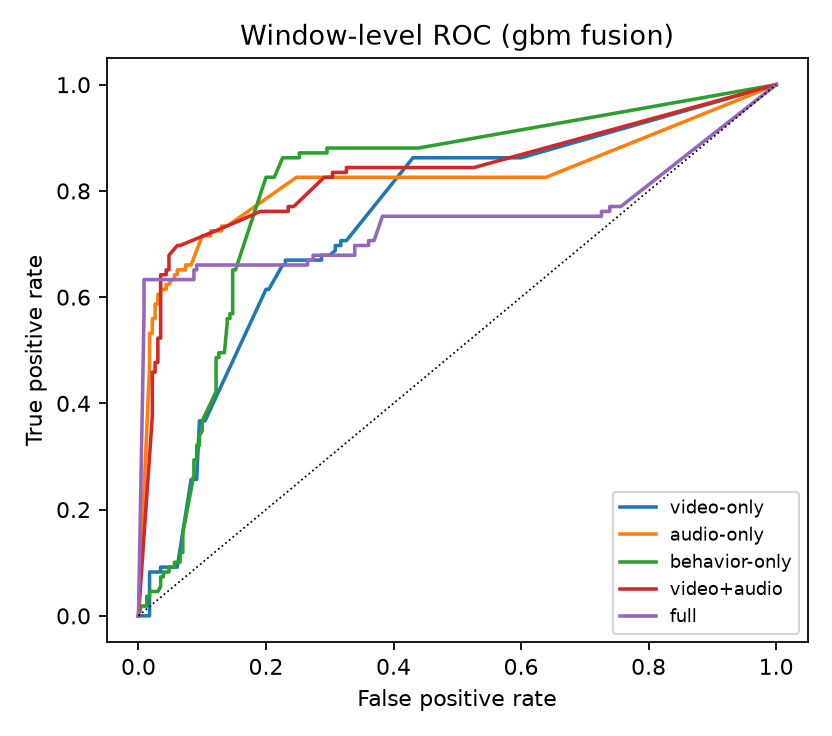

# TrustHire: Multimodal Detection of Fraudulent Remote Job Interviews

*Auto-generated from `results/` on 2026-10-14 09:51 UTC by `python -m trusthire.evaluation.report`. Do not edit
`paper.md` by hand — edit `paper_template.md`.*

## Abstract

Remote hiring has created new attack surfaces: real-time face swaps, cloned voices, proxy candidates and
answers read from AI-generated scripts. We present TrustHire, a streaming system that analyses a live
interview in 3-second windows (50 % overlap) with ten evidence modules — face-forgery detection,
voice anti-spoofing, audio-visual synchrony, face and voice identity continuity, gaze/second-screen
behaviour, rPPG liveness, object detection, scripted-answer analysis and resume consistency — and fuses them
into a calibrated per-window risk timeline and a session trust score with visual and textual explanations.
We report component benchmarks on public datasets, an ablation over modality groups on our own
interview-shaped test set, latency on commodity hardware, and a fairness/robustness analysis.

## 1 Introduction

Public deepfake benchmarks (FaceForensics++, Celeb-DF, ASVspoof) contain short, studio-like clips; real
interview fraud is multimodal, interactive and frequently low-tech (proxies, reading). Our contributions:
(i) an open, real-time multimodal pipeline with per-timestamp evidence; (ii) a confidence-aware fusion layer
that tolerates missing modalities and is calibrated; (iii) an interview-shaped test-set protocol and harness;
(iv) a measured accuracy/latency study on CPU-only hardware.

## 2 System

See `docs/ARCHITECTURE.md`. Browser WebRTC → aiortc ingest (25 fps, 16 kHz) → sliding-window chunker →
parallel branches → fusion → WebSocket dashboard + PDF report. Heavy modules on CPU are scheduled on
alternating windows; because windows overlap by 50 %, alternate windows still tile the timeline contiguously.

| Module | Model (deployed) | Baseline from the brief |
|---|---|---|
| Video deepfake | EfficientNet-B4 (DeepfakeBench, FF++ c23) + temporal head | EfficientNet-B4 / Xception |
| Voice spoofing | Spectra-0 (XLS-R 300M + ECAPA), int8 ONNX | AASIST / RawNet2 / wav2vec2 |
| AV sync | SyncNet (offset ± 7 frames, confidence) | SyncNet / AV-HuBERT |
| Face identity | SCRFD-10G + ArcFace R50 (WebFace600K) | InsightFace ArcFace |
| Voice identity | ECAPA-TDNN (VoxCeleb) | ECAPA-TDNN |
| Behaviour | MediaPipe Face Landmarker (gaze, pose, blinks), reading-sweep detector | MediaPipe Face Mesh |
| Liveness | rPPG POS + CHROM spectral SNR | rPPG |
| Objects | YOLO26n (COCO) | YOLOv8 |
| Transcript | faster-whisper (small int8 CPU / large-v3-turbo GPU), fluency + prosody features, RoBERTa AI-text detector | Whisper |
| Resume | bge-small + FAISS retrieval, DeBERTa-v3 NLI contradiction | RAG |
| Fusion | confidence-weighted log-odds pooling / LightGBM stacker / cross-modal attention + calibration | late fusion + GBM |

## 3 Component evaluation

### 3.1 Voice anti-spoofing (public data, real runs)

| Model | Test set | n | AUC [95% CI] | EER % [95% CI] | TPR@1%FPR | CPU ms/utt |
|---|---|---|---|---|---|---|
| spectra0 | asv19la | 308 | 1.0000 [1.000, 1.000] | 0.00 [0.0, 0.0] | 1.000 | 3327 |
| spectra0_int8 | asv19la | 308 | 1.0000 [1.000, 1.000] | 0.00 [0.0, 0.0] | 1.000 | 1803 |
| aasist | asv19la | 308 | 0.9983 [0.996, 1.000] | 1.62 [0.6, 4.5] | 0.942 | 501 |
| aasist_l | asv19la | 308 | 0.9992 [0.998, 1.000] | 2.27 [0.0, 3.9] | 0.981 | 395 |
| spectra0 | itw | 400 | 0.9978 [0.993, 1.000] | 1.25 [0.5, 3.0] | 0.980 | 3327 |
| spectra0_int8 | itw | 400 | 0.9977 [0.993, 1.000] | 1.25 [0.5, 3.0] | 0.980 | 1803 |
| aasist | itw | 400 | 0.5795 [0.529, 0.633] | 42.50 [38.0, 47.9] | 0.020 | 501 |
| aasist_l | itw | 400 | 0.6175 [0.567, 0.669] | 43.50 [38.0, 47.5] | 0.050 | 395 |

*CPU ms/utt measured 2026-10-12 19:25 on battery power (CPU capped at 1300 MHz) — about 3x slower than on mains power; re-measure plugged in with `python -m trusthire.audio.eval --measure-latency`.*

**Robustness (In-the-Wild subset, same utterances under each degradation):**

| Condition | aasist EER % | spectra0_int8 EER % | spectra0_int8+wpe EER % |
|---|---|---|---|
| clean | 42.50 | 1.25 | – |
| mp3_32k | 41.75 | 2.25 | – |
| noise_snr10 | 57.50 | 7.50 | – |
| noise_snr20_pink | 48.50 | 1.25 | – |
| opus_16k | 47.00 | 3.00 | – |
| reverb_0.25 | – | 21.00 | – |
| reverb_0.4 | 53.00 | 27.50 | 26.50 |
| reverb_0.7 | – | 34.25 | – |
| telephone | 53.00 | 2.00 | – |

### 3.2 Video deepfake detection (cross-dataset)

**Detector selection on the custom recordings** (AI-generated vs real-camera video; the deployed detector is the int8 ONNX export of the top row):

| Model | Input | AUC | Acc@0.5 | mean P(fake) real | mean P(fake) AI | ms/img |
|---|---|---|---|---|---|---|
| haywoodsloan/ai-image-detector-deploy | crop | 1.000 | 1.00 | 0.00 | 0.99 | 2377 |
| haywoodsloan/ai-image-detector-deploy | full | 1.000 | 1.00 | 0.01 | 1.00 | 2333 |
| prithivMLmods/AI-vs-Deepfake-vs-Real-Siglip2 | full | 0.944 | 0.61 | 0.68 | 1.00 | 433 |
| Ateeqq/ai-vs-human-image-detector | crop | 0.889 | 0.33 | 1.00 | 1.00 | 405 |
| Ateeqq/ai-vs-human-image-detector | full | 0.875 | 0.33 | 1.00 | 1.00 | 404 |
| umm-maybe/AI-image-detector | full | 0.861 | 0.67 | 0.15 | 0.27 | 477 |
| prithivMLmods/Deep-Fake-Detector-v2-Model | crop | 0.833 | 0.67 | 0.43 | 0.60 | 505 |
| umm-maybe/AI-image-detector | crop | 0.736 | 0.78 | 0.27 | 0.42 | 589 |
| effnb4 (current) | full | 0.708 | 0.67 | 0.31 | 0.47 | 132 |
| prithivMLmods/AI-vs-Deepfake-vs-Real-Siglip2 | crop | 0.611 | 0.72 | 0.04 | 0.16 | 389 |
| xception | full | 0.264 | 0.67 | 0.39 | 0.32 | 194 |
| dima806/deepfake_vs_real_image_detection | full | 0.250 | 0.67 | 0.08 | 0.00 | 511 |
| xception | crop | 0.139 | 0.39 | 0.45 | 0.21 | 194 |
| prithivMLmods/Deep-Fake-Detector-v2-Model | full | 0.097 | 0.33 | 0.87 | 0.82 | 531 |
| dima806/deepfake_vs_real_image_detection | crop | 0.042 | 0.22 | 0.95 | 0.58 | 517 |
| effnb4 (current) | crop | 0.000 | 0.50 | 0.45 | 0.06 | 123 |

Custom recordings: 6 AI-generated vs 12 real-camera videos, 8 frames each. Small set (one real participant) — indicative only.

### 3.3 Identity verification

**Face (LFW test, 1000 pairs, SCRFD→ArcFace R50):** AUC 0.9860, EER 3.00% (threshold cos 0.121), accuracy 96.90%. At the deployed threshold cos=0.30: same-person false flags 3.60%, impostors missed 0.00%.

**Speaker (LibriSpeech test-clean, 2000 trials, 4 s, ECAPA-TDNN):** AUC 0.9983, EER 1.80%. At the deployed threshold cos=0.25: same-speaker false flags 1.10%, impostors missed 3.40%.

### 3.4 Audio-visual synchrony

Videos: 1; windows: 63.

| Audio shift (frames) | Offset accuracy (±1 frame) | Mean SyncNet conf | Mean risk |
|---|---|---|---|
| -10 (-400 ms) | 100.0% | 5.99 | 1.000 |
| -6 (-240 ms) | 100.0% | 9.22 | 0.750 |
| -4 (-160 ms) | 100.0% | 9.01 | 0.250 |
| -2 (-80 ms) | 100.0% | 8.75 | 0.000 |
| 0 (0 ms) | 100.0% | 8.81 | 0.000 |
| 2 (80 ms) | 100.0% | 8.78 | 0.000 |
| 4 (160 ms) | 100.0% | 8.74 | 0.250 |
| 6 (240 ms) | 100.0% | 8.80 | 0.750 |
| 10 (400 ms) | 100.0% | 8.84 | 1.000 |

Detecting |shift| ≥ 4 frames (160 ms) vs in-sync: AUC 1.000, EER 0.0%.

## 4 Interview test set: ablation study

18 sessions, 16 participants, 339 windows; leave-participants-out CV. Best full-fusion model: `full|gbm`, ECE 0.296.

| Modalities | Fuser | AUC | EER | F1@EER | TPR@1%FPR | TPR@5%FPR | ECE | Session AUC |
|---|---|---|---|---|---|---|---|---|
| all-but-transcript | attention | 0.679 | 45.0% | 0.435 | 0.394 | 0.413 | 0.131 | 0.766 |
| all-but-transcript | gbm | 0.816 | 22.5% | 0.688 | 0.000 | 0.615 | 0.131 | 0.935 |
| all-but-transcript | weighted | 0.775 | 30.0% | 0.593 | 0.119 | 0.349 | 0.131 | 0.792 |
| audio+behavior | attention | 0.760 | 30.4% | 0.596 | 0.239 | 0.431 | 0.099 | 0.961 |
| audio+behavior | gbm | 0.827 | 18.7% | 0.739 | 0.000 | 0.000 | 0.139 | 0.948 |
| audio+behavior | weighted | 0.692 | 33.0% | 0.566 | 0.321 | 0.385 | 0.174 | 0.779 |
| audio-only | attention | 0.757 | 27.4% | 0.629 | 0.367 | 0.367 | 0.134 | 0.831 |
| audio-only | gbm | 0.822 | 21.1% | 0.703 | 0.000 | 0.624 | 0.103 | 0.948 |
| audio-only | weighted | 0.607 | 48.7% | 0.404 | 0.349 | 0.413 | 0.215 | 0.740 |
| behavior-only | attention | 0.711 | 34.9% | 0.548 | 0.083 | 0.284 | 0.103 | 0.805 |
| behavior-only | gbm | 0.809 | 18.7% | 0.735 | 0.018 | 0.092 | 0.120 | 0.870 |
| behavior-only | weighted | 0.534 | 56.0% | 0.336 | 0.028 | 0.156 | 0.167 | 0.779 |
| full | attention | 0.645 | 47.0% | 0.422 | 0.330 | 0.394 | 0.210 | 0.727 |
| full | gbm | 0.748 | 33.0% | 0.567 | 0.633 | 0.633 | 0.296 | 0.812 |
| full | weighted | 0.725 | 35.8% | 0.534 | 0.220 | 0.367 | 0.108 | 0.688 |
| transcript-only | attention | 0.273 | 68.7% | 0.220 | 0.000 | 0.000 | 0.332 | 0.286 |
| transcript-only | gbm | 0.330 | 70.8% | 0.211 | 0.000 | 0.000 | 0.335 | 0.338 |
| transcript-only | weighted | 0.447 | 49.5% | 0.400 | 0.000 | 0.000 | 0.345 | 0.351 |
| video+audio | attention | 0.760 | 29.5% | 0.606 | 0.422 | 0.550 | 0.121 | 0.831 |
| video+audio | gbm | 0.835 | 23.5% | 0.675 | 0.000 | 0.679 | 0.113 | 0.922 |
| video+audio | weighted | 0.637 | 43.1% | 0.458 | 0.349 | 0.349 | 0.123 | 0.714 |
| video+audio+avsync | attention | 0.616 | 47.0% | 0.422 | 0.193 | 0.394 | 0.186 | 0.714 |
| video+audio+avsync | gbm | 0.802 | 23.4% | 0.677 | 0.000 | 0.642 | 0.113 | 0.909 |
| video+audio+avsync | weighted | 0.804 | 26.6% | 0.637 | 0.248 | 0.367 | 0.065 | 0.792 |
| video+behavior | attention | 0.643 | 42.2% | 0.470 | 0.294 | 0.404 | 0.151 | 0.779 |
| video+behavior | gbm | 0.772 | 27.2% | 0.632 | 0.000 | 0.165 | 0.197 | 0.714 |
| video+behavior | weighted | 0.697 | 37.4% | 0.517 | 0.349 | 0.349 | 0.118 | 0.662 |
| video-only | attention | 0.689 | 39.6% | 0.496 | 0.358 | 0.367 | 0.157 | 0.792 |
| video-only | gbm | 0.746 | 30.9% | 0.588 | 0.000 | 0.092 | 0.184 | 0.636 |
| video-only | weighted | 0.725 | 32.1% | 0.576 | 0.358 | 0.422 | 0.073 | 0.753 |

### 4.1 Detection by attack type (threshold at 5 % FPR on genuine windows)

| Attack | Windows | Recall @ 5% FPR (genuine FPR) |
|---|---|---|
| face_and_voice | 38 | 0.921 |
| lip_sync | 27 | 0.926 |
| scripted_reading | 44 | 0.205 |
| genuine | 230 | 0.009 |

## 5 Latency and resources

**CPU** (Intel64 Family 6 Model 154 Stepping 4, GenuineIntel, 12 threads): window p50 **1119 ms**, p95 2124 ms for a 3 s window (hop 1500 ms; real-time factor 0.75); peak RSS 2456 MB. Per-module p50 (ms, concurrent): voice_identity 1513, av_sync 997, voice_spoof 720, video_deepfake 588, face_identity 376, behavior 282, objects 85.

> *Pending — GPU latency. Run `python -m trusthire.evaluation.latency (TRUSTHIRE_PROFILE=gpu)`; this section is filled automatically from the results.*

## 6 Fairness and robustness

Robustness to audio degradations is reported in §3.1. Breakdown of the fused detector by recording
condition and demographic factors on the interview test set:

| Factor | Value | n | AUC | FPR @ global threshold |
|---|---|---|---|---|
| lighting | room A | 256 | 0.937 | 0.009 |
| lighting | room B | 44 | – | – |
| lighting | synthetic | 39 | 1.000 | 0.000 |
| accent | indian-english | 339 | 0.748 | 0.009 |
| webcam | 1080x720 | 206 | 0.473 | 0.012 |
| webcam | 1280x720 | 63 | 0.968 | 0.000 |
| webcam | 2560x1440 | 37 | – | 0.000 |
| webcam | 640x480 | 29 | – | 0.000 |
| webcam | 864x496 | 4 | 1.000 | 0.000 |
| bitrate_kbps | 1099 | 16 | 1.000 | 0.000 |
| bitrate_kbps | 1166 | 7 | – | – |
| bitrate_kbps | 1243 | 7 | – | – |
| bitrate_kbps | 1251 | 7 | – | – |
| bitrate_kbps | 1290 | 7 | – | – |
| bitrate_kbps | 1406 | 7 | – | – |
| bitrate_kbps | 1421 | 15 | – | – |
| bitrate_kbps | 1467 | 12 | – | – |
| bitrate_kbps | 1724 | 29 | – | 0.000 |
| bitrate_kbps | 1726 | 14 | – | – |
| bitrate_kbps | 1727 | 15 | – | – |
| bitrate_kbps | 1757 | 28 | – | 0.000 |
| bitrate_kbps | 1882 | 31 | – | 0.065 |
| bitrate_kbps | 1903 | 37 | – | 0.000 |
| bitrate_kbps | 1968 | 37 | – | 0.000 |
| bitrate_kbps | 4350 | 37 | – | 0.000 |
| bitrate_kbps | 494 | 29 | – | 0.000 |
| bitrate_kbps | 905 | 4 | 1.000 | 0.000 |
| glasses | no | 339 | 0.748 | 0.009 |

## 7 Limitations

See `docs/LIMITATIONS.md` (reproduced in the final report): dataset size and diversity, consent-bound
attack generation, threshold transfer across webcams/codecs, rPPG sensitivity to compression, AI-text
detectors on spoken transcripts, accent effects on ASR-derived features, and the risk of automation bias —
TrustHire produces evidence for human reviewers, not verdicts.

## 8 Ethics

All recordings in the custom set require written informed consent from every participant whose face or
voice is captured or synthesised (template in `docs/DATA_COLLECTION.md`). Deepfakes are generated only of
consenting participants and never distributed.

## References

Rössler et al., FaceForensics++, ICCV 2019 · Li et al., Celeb-DF, CVPR 2020 · Yan et al., DeepfakeBench,
NeurIPS 2023 · Jung et al., AASIST, ICASSP 2022 · Müller et al., Does Audio Deepfake Detection Generalize?,
Interspeech 2022 · Chung & Zisserman, Out of time: automated lip sync in the wild, 2016 · Deng et al.,
ArcFace, CVPR 2019 · Desplanques et al., ECAPA-TDNN, Interspeech 2020 · Wang et al., POS rPPG, IEEE TBME
2017 · de Haan & Jeanne, CHROM, IEEE TBME 2013 · Radford et al., Whisper, 2022 · Guo et al., On Calibration
of Modern Neural Networks, ICML 2017 · Selvaraju et al., Grad-CAM, ICCV 2017 · Lundberg & Lee, SHAP, NeurIPS 2017.
